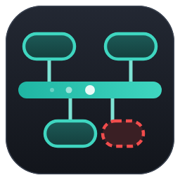
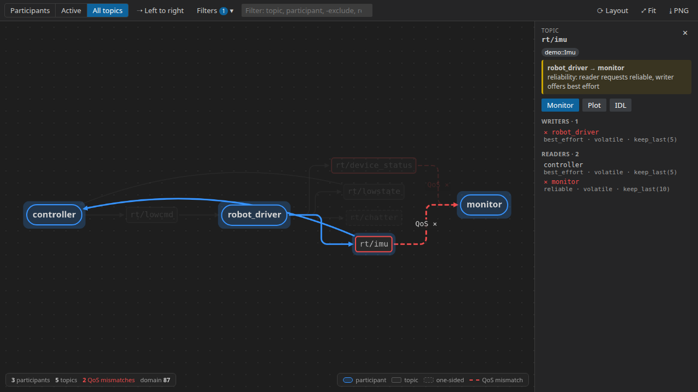
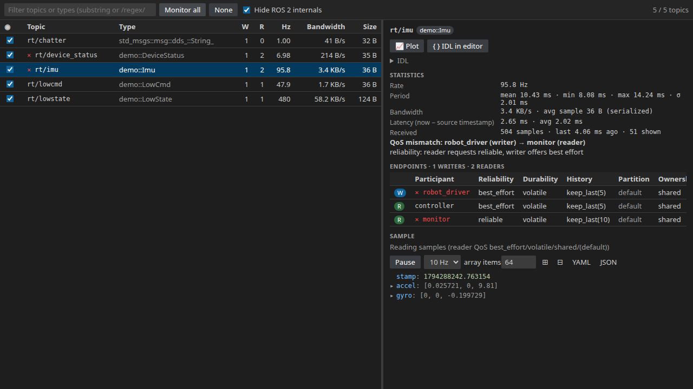
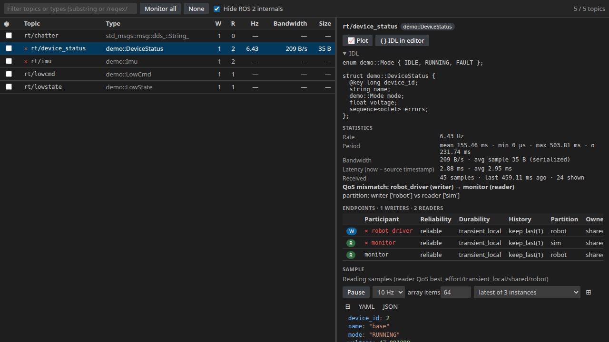
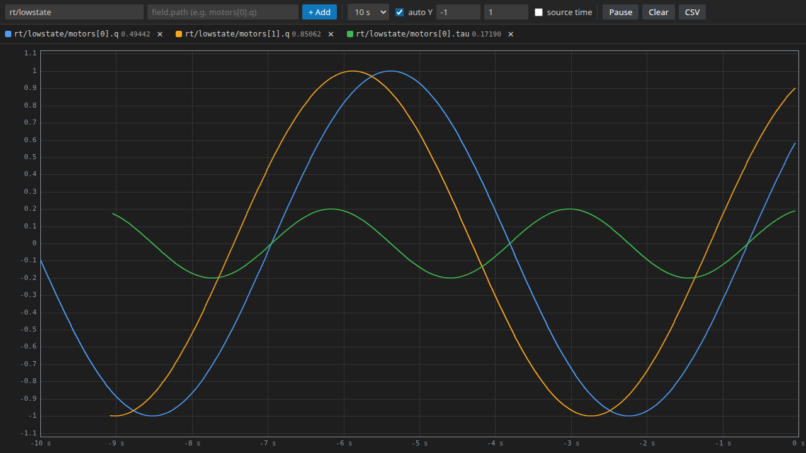

<p align="center"></p>

# Cyclone DDS Visualiser for Visual Studio Code

Inspect Eclipse Cyclone DDS systems inside Visual Studio Code: who talks to whom, with which QoS, how fast, and what the data looks like.


Author: Myeongjin Lee (menggu1234@naver.com)

## Overview

Cyclone DDS Visualiser joins a DDS domain as a passive participant and shows its contents in VS Code panels. Message types are not compiled in. They are fetched at runtime with XTypes type lookup, so any topic whose writer publishes type information can be decoded, without IDL files or generated code.

What you can do:

- See every participant (with host, process and PID) and the topics connecting them.
- Find writer/reader pairs that cannot match, and why: reliability, durability, partitions, ownership, deadline, liveliness, destination order, data representation or type name.
- Measure each topic's rate, bandwidth, sample size and latency, and read live samples, instance by instance for keyed topics.
- See a topic's data type as IDL, and plot any numeric field.

```
 VS Code panels (graph, topics, plot)
        ▲  JSON frames
        │
 extension host ──spawns──▶ python3 dds_backend.py (cyclonedds participant, best-effort readers)
                                  │  RTPS on your domain / network interface
                                  ▼
                       DDS applications (Cyclone DDS, ROS 2, ...)
```



### Supports

| Platform | Status | Notes |
|---|---|---|
| Ubuntu 24.04, `cyclonedds` Python 11.0.1 |  | Development platform. Backend protocol, extension host and UI tests run here against Cyclone DDS applications. |
| Applications using Cyclone DDS C/C++ 0.10 or later |  | Same wire protocol and type lookup as the tested Python applications. |
| Other DDS implementations (Fast DDS, Connext, OpenDDS) |  | Discovery and QoS use standard RTPS and should work. Live samples need XTypes type information from the writer. |
| ROS 2 systems |  | ROS 2 topics appear with their DDS names (`rt/...`). For ROS-level tools, use the ROS 2 Visualiser extension. |
| VS Code Remote (SSH, WSL, Dev Containers) |  | The extension runs on the remote host, so it joins that host's network. |
| Windows, macOS |  | The backend is plain Python. Not verified. |

## Contents

- [Overview](#overview)
  - [Supports](#supports)
- [Quick Start](#quick-start)
- [1. Package Layout](#1-package-layout)
- [2. Installation](#2-installation)
  - [2.1 Requirements](#21-requirements)
  - [2.2 Install the Cyclone DDS Python package](#22-install-the-cyclone-dds-python-package)
  - [2.3 Install the extension](#23-install-the-extension)
  - [2.4 Check](#24-check)
  - [2.5 Uninstall](#25-uninstall)
- [3. Usage](#3-usage)
  - [3.1 Sidebar and status bar](#31-sidebar-and-status-bar)
  - [3.2 DDS Graph](#32-dds-graph)
  - [3.3 Topic Monitor](#33-topic-monitor)
  - [3.4 Plot](#34-plot)
  - [3.5 QoS mismatch checks](#35-qos-mismatch-checks)
  - [3.6 ROS 2 systems](#36-ros-2-systems)
  - [3.7 Demo data](#37-demo-data)
- [4. Configuration](#4-configuration)
  - [4.1 Settings](#41-settings)
  - [4.2 Network configuration](#42-network-configuration)
- [5. Impact on the System](#5-impact-on-the-system)
- [6. Files and Data](#6-files-and-data)
- [7. Troubleshooting](#7-troubleshooting)
- [8. Performance](#8-performance)
- [9. Known Limitations](#9-known-limitations)
- [10. License](#10-license)
- [11. Third-Party Notices](#11-third-party-notices)

## Quick Start

```bash
$ python3 -m venv ~/.venvs/dds && ~/.venvs/dds/bin/pip install cyclonedds
$ code --install-extension mjlee111.cyclonedds-visualiser
```

In VS Code settings, set `ddsVis.pythonPath` to `~/.venvs/dds/bin/python` and `ddsVis.domainId` to your domain. Then click the **Cyclone DDS** icon in the Activity Bar. The status bar shows `DDS D<domain> · <n> participants · <m> topics` once the backend is connected.

## 1. Package Layout

The extension is published on the Visual Studio Marketplace as `mjlee111.cyclonedds-visualiser`. Each version is one package file, `cyclonedds-visualiser-<version>.vsix`. It contains:

```
cyclonedds-visualiser-<version>.vsix
└── extension/
    ├── package.json               manifest: commands, views, settings
    ├── README.md                  this document
    ├── CHANGELOG.md               release history
    ├── LICENSE.txt                MIT license (§10)
    ├── THIRD_PARTY_NOTICES.md     licenses of bundled libraries (§11)
    ├── dist/extension.js          extension host code
    ├── dist/webview/*.js, *.css   panel UIs, include cytoscape (§11)
    ├── python/dds_backend.py      backend, started by the extension
    ├── python/dds_demo.py         demo application (§3.7)
    └── media/                     icons
```

The Cyclone DDS Python package is not bundled. You install it (§2.2).

## 2. Installation

### 2.1 Requirements

| Item | Requirement |
|---|---|
| VS Code | 1.85 or later |
| Python | 3.10 or later (required by `cyclonedds` 11) |
| Cyclone DDS Python package | `cyclonedds` 11.x (tested 11.0.1). It ships its own Cyclone DDS C library. |
| Applications | Writers must publish XTypes type information to decode their samples (Cyclone DDS 0.10 and later do so by default) |
| Network | DDS traffic on the configured domain and interface. No internet access. |

### 2.2 Install the Cyclone DDS Python package

Ubuntu 24.04 protects the system Python, so use a virtual environment:

```bash
$ python3 -m venv ~/.venvs/dds
$ ~/.venvs/dds/bin/pip install cyclonedds
$ ~/.venvs/dds/bin/python -c "import cyclonedds; print('ok')"
```

Then set `ddsVis.pythonPath` to `~/.venvs/dds/bin/python`. If `cyclonedds` is already importable from `/usr/bin/python3`, for example through a user install, no setting is needed.

### 2.3 Install the extension

Open the Extensions view, search for **Cyclone DDS Visualiser** (publisher `mjlee111`), and click **Install**. Or, from a terminal:

```bash
$ code --install-extension mjlee111.cyclonedds-visualiser
```

**Offline install from a `.vsix` file**

```bash
$ code --install-extension cyclonedds-visualiser-<version>.vsix
```

To reinstall a build with the same version number, add `--force`.

### 2.4 Check

The status bar shows the connection, plus the number of QoS mismatches if there are any:

```
DDS D0 · 3 participants · 5 topics · ⚠ 2 QoS
```

**DDS: Show Backend Log** opens the **Cyclone DDS Visualiser** output channel:

```
starting backend: /home/me/.venvs/dds/bin/python (domain 0)
[dds_backend] started {"domainId": 0, "cyclonedds": "11.0.1", ...}
```

### 2.5 Uninstall

```bash
$ code --uninstall-extension mjlee111.cyclonedds-visualiser
```

## 3. Usage

### 3.1 Sidebar and status bar

The **Cyclone DDS** view in the Activity Bar has two sections:

- **Tools** opens the DDS Graph, the Topic Monitor and the Plot.
- **DDS Explorer** has three groups:
  - **Participants**, grouped by host, with their writers and readers (topic, type, QoS).
  - **Topics**, with writer and reader counts.
  - **QoS Mismatches**, which lists every writer/reader pair that cannot match.

  Right-click a topic to monitor it, plot it, show its type as IDL, or copy its name.

Click the DDS item in the status bar for a quick list of tools. All commands are in the Command Palette under the **DDS** category.

### 3.2 DDS Graph

- Participants are drawn as rounded boxes, labelled with their entity name or, if they have none, with process and PID. Topics are rectangles.
- **Participants**, **Active** (topics with both writers and readers) and **All topics** views. One-sided topics are dashed.
- A reader that cannot match its topic's writers is connected with a **red dashed edge** marked `QoS ✕`. Click the topic or the participant for the reasons.
- **Filters** hide ROS 2 infrastructure topics, dead sinks and unfed topics, group participants by host, and show the rate of every topic.
- The filter box takes comma-separated names or regular expressions. Prefix a term with `-` to exclude it.
- **PNG** saves the graph as an image.

### 3.3 Topic Monitor



- Every topic with its type, writer and reader counts, rate, bandwidth and serialized sample size. Tick a topic, or **Monitor all**, to measure it.
- Select a topic to see:
  - the period statistics
  - the latency (reception time minus the writer's source timestamp)
  - every endpoint with its participant and QoS (reliability, durability, history, partitions, ownership, deadline, liveliness)
  - the mismatch reasons
  - the type as IDL
  - the live sample tree
- Keyed topics get an instance selector, so each instance can be followed separately.
- Click 📈 next to a numeric field to plot it, or copy the sample as YAML or JSON.



### 3.4 Plot



- Add `topic` + `field` pairs. Field paths autocomplete from the resolved type (`motors[0].q`, `imu_rpy[2]`, ...).
- Time axis from reception time or from the DDS source timestamp. Window from 5 s to 300 s, automatic or fixed Y range.
- Hover for values, click a legend item to hide it, **CSV** exports the visible data.

### 3.5 QoS mismatch checks

For every writer/reader pair on the same topic, the extension reports why they cannot match:

| Check | Mismatch when |
|---|---|
| Type | Type names differ |
| Reliability | Reader requests reliable, writer offers best effort |
| Durability | Reader requests a stronger durability than the writer offers |
| Ownership | Shared vs exclusive |
| Deadline | Writer's deadline is longer than the reader's |
| Liveliness | Writer's kind is weaker or its lease longer than the reader's |
| Destination order | Reader requests by-source-timestamp, writer offers by-reception |
| Data representation | No common representation (XCDR1 / XCDR2) |
| Partition | No partition in common (wildcards supported) |

These checks follow the DDS request/offered rules. They are computed from discovery data, so they also cover pairs on remote machines.

### 3.6 ROS 2 systems

ROS 2 topics appear with their DDS names: `/chatter` becomes `rt/chatter` with type `std_msgs::msg::dds_::String_`. Services appear as `rq/.../...Request` and `rr/.../...Reply`. Hovering over such a topic shows the ROS 2 name and type. **Hide ROS 2 internals** removes `rt/rosout`, `rt/parameter_events`, `ros_discovery_info`, services and action topics. For ROS-level tools (nodes, parameters, URDF), use the ROS 2 Visualiser extension.

### 3.7 Demo data

The extension ships a demo application with three participants:

- **robot_driver**: writes `rt/lowstate` (about 500 Hz), `rt/imu`, the keyed `rt/device_status` (partition `robot`, transient local) and `rt/chatter`.
- **controller**: reads the state and writes `rt/lowcmd`.
- **monitor**: has two readers that deliberately do not match, one because of reliability and one because of the partition.

Run it on an unused domain:

```bash
$ ~/.venvs/dds/bin/python ~/.vscode/extensions/mjlee111.cyclonedds-visualiser-<version>/python/dds_demo.py --domain 87
```

Then set `ddsVis.domainId` to `87`.

## 4. Configuration

### 4.1 Settings

Open **File > Preferences > Settings** and search for `ddsVis`. Changing any of these restarts the backend.

| Setting | Default | Description |
|---|---|---|
| `ddsVis.pythonPath` | `""` | Interpreter with the `cyclonedds` package, for example `~/.venvs/dds/bin/python`. Empty uses `/usr/bin/python3` on Linux if present, else `python3`. |
| `ddsVis.domainId` | `0` | DDS domain to inspect (0–232). |
| `ddsVis.cycloneddsUri` | `""` | Cyclone DDS configuration for the backend (`CYCLONEDDS_URI`): a file path, a `file://` URI or inline XML. `${workspaceFolder}` is expanded. Empty inherits the environment. |
| `ddsVis.graphPollInterval` | `1.0` | Seconds between discovery snapshots (minimum 0.2). |
| `ddsVis.typeLookupTimeout` | `5` | Seconds to wait for a topic's XTypes type information. |
| `ddsVis.reliableReaders` | `false` | Use reliable readers on topics whose writers are all reliable (see §5). |

### 4.2 Network configuration

The backend joins the network like any other Cyclone DDS application. To select the network interface, or to discover a robot without multicast, point `ddsVis.cycloneddsUri` to a configuration file:

```xml
<CycloneDDS>
  <Domain id="any">
    <General>
      <Interfaces><NetworkInterface name="eth0"/></Interfaces>
    </General>
    <Discovery>
      <Peers><Peer Address="192.168.123.161"/></Peers>
    </Discovery>
  </Domain>
</CycloneDDS>
```

Use the same interface and peers as the applications you want to inspect.

## 5. Impact on the System

The extension is read-only. It never writes DDS data.

- It creates one participant on the configured domain. Other applications see it in their own discovery. The graph and explorer hide it.
- It creates a reader only for topics shown in an open panel (a selected topic, a ticked topic, **Monitor all**, a plot, graph rates), and deletes it when the panel no longer needs it.
- Readers are **best-effort by default**. They never apply back-pressure to writers, even when VS Code is slow, but under heavy load they may miss samples, and they do not receive transient-local history. `ddsVis.reliableReaders` switches to reliable readers on reliable topics. A slow reliable reader can then delay writers that use KEEP_ALL history.
- Each reader receives the topic's data, which adds network traffic. **Monitor all** on a system with camera or point cloud topics can add a lot of it.

## 6. Files and Data

- The extension writes files only where you choose in a save dialog (graph PNG, plot CSV).
- It reads no files from your workspace.
- It makes no internet requests. All traffic is DDS traffic on the configured domain.

## 7. Troubleshooting

Messages appear in a notification, in the panel, or in the **Cyclone DDS Visualiser** output channel (**DDS: Show Backend Log**).

| Message | Cause | Fix |
|---|---|---|
| `The backend cannot import the Cyclone DDS Python package ...` | `cyclonedds` is not installed for the interpreter in use | Install it (§2.2) and set `ddsVis.pythonPath` |
| `cannot create a DomainParticipant: ...` | Invalid domain ID or `CYCLONEDDS_URI` | Check `ddsVis.domainId` and the configuration file |
| Status bar shows `0 participants` | Different domain, or another network interface or multicast setting than the applications | Set `ddsVis.domainId`. Configure the interface or peers (§4.2) |
| `no endpoint of this topic publishes XTypes type information` | The writers use an older Cyclone DDS or another implementation without type lookup | Discovery, QoS and graph still work. Samples cannot be decoded |
| `type lookup failed: [DDS_RETCODE_TIMEOUT] ...` | The writer's type lookup service did not answer in time | Raise `ddsVis.typeLookupTimeout`. Check that unicast traffic to the writer's host is possible |
| `Waiting for a writer or reader of this topic…` | The topic has no endpoints (any more) | Start the application |
| Red `✕` on a topic, or **QoS Mismatches** in the explorer | A reader cannot match a writer | Read the reasons and align the QoS (§3.5) |
| Samples missing or rate lower than expected | Best-effort readers drop samples under load | Enable `ddsVis.reliableReaders`, or monitor fewer topics |
| `backend crashed repeatedly; not restarting automatically` | The backend failed four times within a minute | Read the log, fix the cause, then run **DDS: Restart Backend** |

## 8. Performance

Measured on Ubuntu 24.04, AMD Ryzen 9 9900X, with the demo application on the loopback interface. Panels ran in Chrome through the development harness, not inside VS Code.

| Data | Result |
|---|---|
| `rt/lowstate` (124 B samples), all samples counted | 478 Hz, 58 KB/s measured |
| `rt/imu` (36 B), plotted sample by sample | 96 Hz, every sample plotted |
| Type lookup of a nested struct (`demo::LowState`) | under 10 ms |
| Latency, source timestamp to backend | 0.6 ms (2 ms average) |

Rate and bandwidth are counted on serialized samples. Only the samples that are displayed or plotted are decoded, which in Python is the expensive step.

## 9. Known Limitations

- Read-only: there is no publisher, and samples cannot be written.
- Decoding needs XTypes type information from the writer (or from another endpoint on the topic).
- The IDL view shows structs, enums, arrays, sequences, bounded strings and `@key`. Union cases and other annotations are not rendered.
- Disposed and unregistered instances are not shown separately.
- Large samples (images, point clouds) are counted correctly, but are not rendered as images or 3D views.
- Other DDS implementations, ROS 2 systems, VS Code Remote, Windows and macOS have not been tested (see Supports).

## 10. License

Copyright (c) 2026 Myeongjin Lee.

Released under the MIT License. The full text is in [LICENSE](LICENSE). You may use, copy, modify and redistribute the software, provided the copyright and license notices, including those in §11, stay in place. The software is provided "as is", without warranty of any kind.

Eclipse Cyclone DDS and Eclipse are trademarks of the Eclipse Foundation. This extension is not affiliated with or endorsed by the Eclipse Foundation.

## 11. Third-Party Notices

`dist/webview/*.js` include the following open-source components, all under the MIT License. The full license texts are in [THIRD_PARTY_NOTICES.md](THIRD_PARTY_NOTICES.md).

| Component | License |
|---|---|
| [Cytoscape.js](https://js.cytoscape.org) | MIT, © The Cytoscape Consortium |
| [cytoscape-dagre](https://github.com/cytoscape/cytoscape.js-dagre) | MIT, © The Cytoscape Consortium |
| [dagre](https://github.com/dagrejs/dagre) | MIT, © Chris Pettitt |
| [graphlib](https://github.com/dagrejs/graphlib) | MIT, © Chris Pettitt |
| [lodash](https://lodash.com) | MIT, © OpenJS Foundation and other contributors |

The backend imports the [Cyclone DDS Python package](https://github.com/eclipse-cyclonedds/cyclonedds-python) (EPL-2.0 or BSD-3-Clause), which you install separately. It is not part of this extension.
